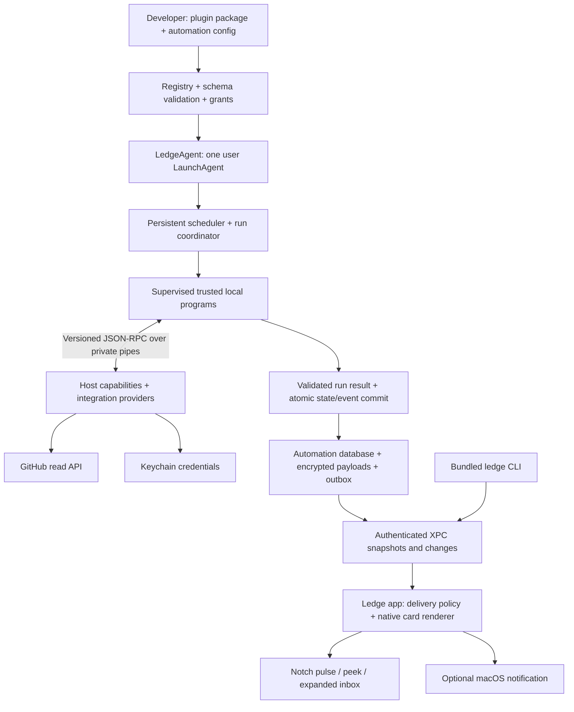

# Ledge developer automation platform — design

Date: 2026-10-26. Status: proposed redesign, ready for review; this document does not describe implemented functionality.

## 1. Product decision

Ledge becomes a local automation host with a macOS notch interface. Developers supply programs and configuration. Ledge supplies scheduling, integration access, durable state, execution supervision, notification policy, native cards, and debugging tools.

The first complete workflow is: select GitHub repositories → check for contribution opportunities on a schedule → explain new matches → briefly expand the notch → open or save a useful issue.

The user explicitly chose direct distribution because running local scripts is essential. Preserve the native Swift 6/macOS 15 application; distribute a Developer ID signed and notarized app. Mac App Store compatibility is not a release requirement for this edition. All architecture, limits, and defaults below are recommendations unless marked as an explicit user decision.

Success means someone can build a useful Python, JavaScript/TypeScript, shell, or compiled-program integration without modifying Ledge, writing SwiftUI, managing OAuth tokens in their plugin, implementing cron plumbing, or designing notification windows.

## 2. Approaches and recommendation

| Approach | Benefits | Costs |
| --- | --- | --- |
| Continue adding built-in Swift features | Small architectural change | Every integration requires an app release; fails the custom-code requirement |
| Embed a general Node/web application plugin runtime | Familiar UI ecosystem; extensive dynamic UI | Runtime/bundling cost, arbitrary UI and resource use, more difficult notch consistency |
| Native host + supervised external programs + structured native UI | Any language, existing tools, native notch, shared reliability and integration services | Requires a real protocol, scheduler, credential broker, and clear execution trust model |

Recommend the third approach. Begin with trusted local programs and bundled providers. Later add restricted declarative extensions and only then evaluate a constrained executable runtime. Do not promise that arbitrary native scripts can become safely sandboxed through a manifest.

## 3. Current repository: what changes

Evidence inspected in this checkout:

| Current code | Keep / change |
| --- | --- |
| `Packages/LedgeKit/Package.swift` | Keep Swift package boundaries and macOS 15 floor; add automation modules |
| `ShellFeature/ShellPanel.swift`, `ShellReducer.swift` | Reuse native presentation and state concepts; connect actual lifecycle events |
| `ShellFeature/ShelfGeometryResolver.swift` | Replace placement for notch mode: currently centers a panel below the menu-bar inset and ignores auxiliary top regions |
| `ShellFeature/HoverTriggerPanel.swift` | Connect in production; currently defined but never constructed by the production app |
| `LedgeApp/App/AppDelegate.swift` | Split hard-coded feature composition, display handling, and services into injected coordinators |
| `AppEnvironment.live`, `AppCoordinator.swift` | Replace empty initial candidates/fixed feature dispatch with event subscriptions and dynamic plugin/command IDs |
| `LedgeDomain/ActionCandidate.swift` | Keep urgency/sensitivity/expiry concepts; closed `FeatureID` and `ShelfCommand` enums cannot represent third-party plugins |
| `LedgeStorage/*` | Reuse audited crypto/Keychain patterns; keep shelf data separate from a new automation database |
| `Settings/LoginItemController.swift` | Existing `.mainApp` login setting is not a background job runner; add a separately registered agent |
| `Ledge.entitlements`, `docs/architecture/public-api-boundaries.md` | Existing sandbox/no-network/no-helper assumptions conflict with the new product and require deliberate revision |
| Xcode project and shared scheme | Only the app target is registered; UI/integration/performance folders are not runnable test targets yet |

No scheduler, executable plugin runner, GitHub integration, durable job/run ledger, or plugin protocol is implemented today. Previous shelf features become bundled adapters progressively; preserve their data and recovery paths during migration.

## 4. Architecture and ownership



**Ledge.app** owns AppKit/SwiftUI, display geometry, keyboard interaction, configuration and consent, the notch inbox, and optional macOS notification delivery. No job executes on its main actor.

**LedgeAgent** owns the automation database, scheduler, child processes, integration requests, credentials, execution history, and event outbox. One bundled user LaunchAgent is registered with `SMAppService.agent(plistName:)`; no root daemon and no generated crontab/plist per plugin. Agent registration and its approval state are explicit settings. Apple supports this bundled registration pattern through [SMAppService](https://developer.apple.com/documentation/servicemanagement/smappservice).

**The CLI** is a signed executable bundled with the application. It uses the same agent APIs as Settings. Installing a shell shim is optional and explicit. Plugin child processes receive a private inherited channel for their run; they never connect as administrators of the agent.

**An integration provider** implements a named service contract such as `github.issues.read`. The host selects the account, attaches credentials, handles quotas and pagination, and returns typed data. V1 providers are bundled signed Swift modules. Their registry is extensible, but external providers needing new secret/network authority are added in an app release until a restricted provider runtime exists.

**A plugin** declares jobs, commands, configuration fields, requested capabilities, and result schemas. It produces events and cards through host APIs. It cannot register a window, supply native libraries to load into the UI, or replace the scheduler.

## 5. Trust, distribution, and process model

Support three explicit classes, with only the first two needed for the initial release:

1. `bundled.native`: first-party adapters compiled into the signed application. Same plugin registry and presentation contracts; framework-level access remains host-owned.
2. `local.command`: user-trusted Python, Node, shell, or native executables running with the logged-in user's access. Separate process per invocation; no automatic elevated privileges. Capability grants constrain broker services, not the script's independent access to the machine or network.
3. Future `restricted.workflow`: declarative operations, predicates, transforms, and host cards with no arbitrary native execution. A later WASM design requires its own vetted runtime and import policy; it will not transparently run arbitrary Python/shell programs.

The direct developer edition deliberately removes App Sandbox from the executable runner; the UI and agent signing/entitlement design is tested together before release. Keep Hardened Runtime and library validation. Never disable library validation just to load plugin dylibs. Apple distinguishes the [Process lifecycle](https://developer.apple.com/documentation/foundation/process), [sandbox inheritance](https://developer.apple.com/documentation/xcode/configuring-the-macos-app-sandbox), and [distribution requirements](https://developer.apple.com/documentation/xcode/preparing-your-app-for-distribution).

Operational limits are still valuable: absolute executable paths, argv arrays, explicit working directory, minimal environment, bounded stdout/stderr, timeouts, cancellation, and per-job state namespaces. They do not contain hostile same-user native code. Forked children that intentionally detach are outside the supported cooperative local-command contract; process groups are not a hostile-code containment mechanism.

Install/download does not imply execution. Remote source stays disabled until the user trusts it. No automatic `npm install`, `pip install`, shell install hook, or package lifecycle script. Release packages pin content hashes and dependencies. A `dev link` explicitly opts one local directory into live-source behavior; record its content hash at each run and disable real schedules by default in preview mode.

## 6. Notch as the main interface

The default install creates no persistent menu-bar status item. An optional recovery icon may be enabled in Settings; it contains controls, not plugin output. Opening Ledge from Finder or Spotlight when it is already running reveals the notch. The hotkey and `ledge ui open` also work. Settings and Developer Console are normal windows reachable from the notch, app reopening, and CLI.

The notch is physical screen geometry, not a drawable area. Use `NSScreen.safeAreaInsets`, `auxiliaryTopLeftArea`, and `auxiliaryTopRightArea` to derive the camera span; Apple exposes these [safe areas](https://developer.apple.com/documentation/appkit/nsscreen/safeareainsets) and [unobscured top regions](https://developer.apple.com/documentation/appkit/nsscreen/auxiliarytopleftarea-uglc). Connect a small tracking region immediately below the housing and render content below it. The black surface touches the housing's lower edge so it appears attached. Never place text in the camera gap or a full-width invisible window over menu-bar controls.

```text
Idle                          New event                       Expanded by hover / hotkey
       [physical notch]             [physical notch]                 [physical notch]
                                  ╰  2 opportunities  ╯       ╭──────────────────────────────╮
                                                             │ GitHub · 2 new opportunities  │
                                                             │ repo/name #123 · 82 match     │
                                                             │ Open · Save · Snooze · Why?   │
                                                             ╰──────────────────────────────╯
```

State machine: `hidden → pulse → peek → expanded → hidden`. Manual reveal may go directly to `expanded`. The unread count is durable data, not a reason to leave a large panel visible.

- Hidden: no visible panel; small notch tracking region only on the selected notched screen.
- Pulse: one reduced-motion-aware 180 ms accent; no infinite animation.
- Peek: content-neutral summary, at most 5 seconds; does not become key or change active application.
- Expanded: intentional 250 ms hover dwell, click, or hotkey; bounded native list/detail card, max 560×420 points before screen clamping. Pointer exit starts a 350 ms grace period; entering card or keyboard editing cancels it. Escape closes.
- Keyboard: arrow keys select, Return runs the default safe action, Space previews details, Command-comma opens Settings, Escape returns/closes. Preserve the existing shelf shortcut unless conflicted. Do not invent a second shortcut namespace for every plugin.
- Hover never steals focus. Make the panel key only for explicit keyboard input and return to the previous application when finished.
- Selected screen uses a real display ID derived from `NSScreenNumber`/CoreGraphics, not its name; determine built-in status with `CGDisplayIsBuiltin`.
- Default target is the built-in notched display. If unavailable/closed, explicit reveal uses the pointer display or configured external display. Notchless screens use a transient top-center card; no permanent toolbar substitute.
- Recompute geometry and migrate/collapse on hot-unplug, mirroring, resolution/scale changes, or Space changes. Ordinary notifications do not join another app's full-screen Space. Explicit hotkey reveal may use an auxiliary panel there. When visibility is uncertain, keep the event in the inbox rather than promise automatic full-screen detection.
- Manual presentation-safe mode and user quiet hours suppress automatic detail peeks; sensitive titles are redacted on external displays by default. Permission to show OS notifications is independent.

The renderer sizes the actual panel to the active state. Do not keep a 520×160 invisible hit target around a 62-point pill. Each event updates the current view model; receiving a new event must not reinstall Home over a focused editor.

## 7. Developer contract

Separate reusable plugin definition from each configured automation instance. A developer installs one GitHub watcher plugin and creates several differently configured jobs from it.

Proposed package manifest (`ledge-plugin.json`):

```json
{
  "$schema": "https://ledge.dev/schemas/plugin-v1.json",
  "schemaVersion": 1,
  "id": "dev.example.github-opportunities",
  "version": "0.1.0",
  "hostProtocol": "1",
  "name": "GitHub Opportunities",
  "runtime": { "kind": "local.command", "entry": "watch.py", "interpreter": "python3" },
  "capabilities": ["github.issues.read", "github.pullRequests.read", "state.readwrite", "events.publish"],
  "configSchema": "config.schema.json",
  "commands": ["scan", "revalidate-issue"],
  "defaultCommand": "scan"
}
```

The schema URL is a proposed identifier, not an existing hosted service. Ship the actual schema in the SDK/CLI and validate offline. Installation resolves `python3` to a user-selected absolute executable and persists that path; do not rely on a login-shell PATH. TypeScript templates build to JavaScript using the developer's chosen Node and lockfile. V1 does not download runtimes or require Docker.

Proposed automation instance (`ledge.json`):

```json
{
  "schemaVersion": 1,
  "automations": [{
    "id": "oss-opportunities",
    "plugin": "dev.example.github-opportunities@0.1.0",
    "command": "scan",
    "connection": "github-personal",
    "schedule": { "cron": "*/15 * * * *", "timezone": "Asia/Kolkata", "misfire": "run-latest", "jitterSeconds": 60 },
    "enabled": true,
    "config": {
      "repositories": ["owner/repository"],
      "profile": "strict-contribution",
      "labelsAny": ["good first issue", "help wanted"],
      "createdSince": null,
      "minimumScore": 70,
      "firstRun": "baseline"
    },
    "delivery": { "surface": "notch", "mode": "digest", "quietHours": ["22:00", "08:00"] }
  }]
}
```

V1 configuration format is JSON plus JSON Schema; GUI is generated from the same schema. Examples use placeholders, not an inferred repository watchlist. Importing config validates/diffs first; replacing a whole file cannot silently delete unrelated automations. Credentials never appear in exported configuration. Invalid replacement preserves the last valid version.

Developer workflow (commands proposed, not available today):

```sh
ledge init github-opportunities --template github-issues --language python
ledge validate ./github-opportunities
ledge dev ./github-opportunities --fixture ./fixtures/new-match.json
ledge test ./github-opportunities
ledge connect github --name github-personal
ledge plugin install ./github-opportunities
ledge automation apply ./ledge.json
ledge run oss-opportunities --dry-run
ledge runs list --automation oss-opportunities
ledge logs --run RUN_ID --follow
ledge ui open
```

`dev` uses recorded integration responses and an isolated state namespace by default, previews real native cards, and never enables a schedule. `run --dry-run` passes an explicit cooperative mode to the program: granted integration reads are allowed, but Ledge does not commit plugin state, publish real notifications, or expose mutating broker operations. A trusted local program can still independently write files or call external APIs; this mode is not a side-effect-free sandbox. The generated templates honor the mode for their own operations. Output is machine-readable with `--json`; exit codes are stable: 0 success, 2 invalid configuration, 3 missing capability/connection, 4 runtime failure, 5 timeout, 6 runner unavailable. Inspector shows input, events, state diff, run logs, next five due times, and capability decisions.

### Protocol v1

Use bidirectional JSON-RPC 2.0 newline framing over the child's stdin/stdout. Stderr is bounded diagnostic text. Stdout is protocol-only; SDK `ctx.log` routes diagnostics correctly. Raw programs can support the protocol without an SDK. A wrapper template adapts an existing command that outputs one validated JSON result.

The host sends `run` or `command` with run ID, automation ID, command, immutable configuration, UTC scheduled/start times, deadline, execution mode, and protocol version. The child can request `host.integration.call`, `host.state.get`, `host.records.query`, and `host.log`. Host identity/grants come from the inherited channel, never a plugin-supplied plugin ID. The final response contains `events`, `statePatches`, `recordMutations`, and `summary`; the host commits them only after schema validation and successful process exit.

State is a 64 KiB document plus a generic plugin-instance record collection, capped at 25 MiB/50,000 records, with 16 KiB per record. Read pages contain at most 100 records/128 KiB. Records have plugin-defined collection/key strings, version, and JSON value; query supports key prefix, version and stable continuation, not arbitrary SQL. Final-result upsert/delete mutations commit atomically with the run's checkpoint/events. The watcher stores baselines, evidence summaries and pending enrichment in these ordinary records; there is no privileged GitHub-only plugin database API.

Limits: 256 KiB per frame, including the entire final response; 2 MiB total child-to-host protocol bytes per run; 100 events per run; 1 MiB captured logs per run. Large backfills use bounded segments and persisted continuations rather than oversized final results. Reject unsupported major versions before execution. Unknown optional fields are ignored only where the schema explicitly permits them. Cancellation closes host calls, sends SIGTERM to the invocation process group, allows 3 seconds, then sends SIGKILL to remaining cooperative children.

SDKs expose the same contract: Python first, TypeScript second; language-neutral fixtures and schema tests define compatibility. SDK helpers do not implement scheduling or retry their own integration calls.

## 8. Durable scheduling and lifecycle

`launchd` supervises the single agent; Ledge's scheduler evaluates job schedules. Use one timer for the nearest deadline, not a timer/process per plugin and not a one-second global polling loop. Persist UTC due times, the explicit IANA timezone, schedule revision, run leases, and retry state.

- V1 schedules: manual; interval ≥60 seconds; five-field cron (minute/hour/day-of-month/month/day-of-week) supporting `*`, numeric lists, ranges and steps. Sunday 0 or 7; day-of-month/day-of-week use conventional OR when both constrained. Reject six-field cron, macros, `L/W/#`, named fields, and invalid timezones with useful errors.
- Cron is wall-clock time in its configured zone. Skip nonexistent DST local times; execute an ambiguous fall-back local minute once. Use a local occurrence key plus schedule revision to prevent a duplicate fold firing. Show next five occurrences before Save.
- Interval schedules anchor to the persisted UTC start, and wall-clock/timezone changes do not create bursts. Recompute deadlines on clock change and wake.
- Generic `jitterSeconds` defaults to 0 and is bounded to 60 seconds in v1; the GitHub template sets 60. Derive jitter from the stable occurrence identity, retain the original scheduled timestamp and apply the execution timeout from the actual start time. Retries do not invent a second scheduled occurrence.
- Default misfire is `run-latest`: coalesce missed slots to at most one run whose scheduled time is within 24 hours. `skip` is also supported. No catch-up storm. A backward clock jump must not repeat committed occurrences.
- Maximum two concurrent programs globally and one invocation per automation. If another occurrence arrives during a run, keep at most one pending latest occurrence. Integration provider requests have separate quotas.
- Default run timeout 120 seconds, configurable 5–900 seconds. A timed-out program cannot block unrelated jobs or the notch. One retry of transient runtime failures, after at least 60 seconds with bounded jitter; respect provider retry-after if longer. No automatic retry for invalid configuration, revoked grants, or a failed mutating command with uncertain outcome.
- Three consecutive terminal failures pause automatic runs and publish one grouped health event. Manual Run remains available. A successful manual run can offer Resume; avoid permanent silent failure.
- Each durable occurrence has a unique `(automationID, scheduleRevision, occurrenceKey)` record. Delivery/state commit is idempotent; arbitrary external side effects in custom code are not exactly-once. A process interrupted before commit becomes `interrupted`; automatic replay is allowed only for jobs explicitly marked idempotent/read-only.
- Closing a window/notch leaves the app and runner alive. Standard Quit stops the app's scheduled work by default; a separate explicit “Keep automations running and close interface” option may leave the agent active. A visible “Stop all automations” operation stops scheduling and cancels runs. Persist the chosen lifecycle behavior; launchd must not immediately restart after an intentional stop.
- When only the agent is running, it stores events; the app drains them on reconnect. Notch and OS notification presentation require the GUI notification bridge. Do not launch the GUI repeatedly for each event.

A local Mac cannot execute while powered off; a user agent does not run after logout. Apple recommends [launchd over cron](https://developer.apple.com/library/archive/documentation/MacOSX/Conceptual/BPSystemStartup/Chapters/ScheduledJobs.html). This product supports durable catch-up on wake/login, not an always-on service. A future remote runner is a separate opt-in product and shares event contracts, not an implied cloud dependency.

## 9. Integration and credential broker

The agent stores connection secrets in Keychain and provides typed operations, not raw tokens. A request includes connection alias and operation-specific parameters. Grant scope is `(plugin, automation, provider, account, resources, operation)`. Verify ownership, repository allowlist, request size, pagination bounds and revocation on every broker call.

For GitHub v1, connect a user-supplied fine-grained read token through a secure field or stdin; never argv or config. Validate identity/required permissions and show which repositories are reachable. Public anonymous read is a limited preview; a scoped token is recommended for scheduled use. Do not embed an OAuth client secret or silently reuse all of `gh`'s credentials. Native OAuth onboarding can follow after the local-only authorization flow is verified: current [GitHub OAuth documentation](https://docs.github.com/en/apps/oauth-apps/building-oauth-apps/authorizing-oauth-apps) still requires a client secret for authorization-code exchange, while device flow has a different contract. Do not assume PKCE alone removes that requirement.

Provider v1 operations: `github.issues.listUpdated`, `github.issues.getEvidence`, and `github.pullRequests.findOverlap`. Inputs/outputs are typed and paginated; no plugin-supplied arbitrary GraphQL or unrestricted authenticated URL. Providers normalize unavailable fields into explicit unknown evidence rather than an empty set. Recheck before the primary action.

Generic HTTP is later: explicit HTTPS destination grants, bounded responses, no credentials across redirects, DNS/private-network policy and quotas. Trusted local programs can use their own networking; the host cannot prevent it. A provider extension SDK does not confer access to existing connection secrets.

GUI↔agent↔CLI control IPC uses signed identifiers and Team ID requirements on public `NSXPCConnection`, with user/session and role checks before accepting messages. Use [setCodeSigningRequirement](https://developer.apple.com/documentation/foundation/nsxpcconnection/setcodesigningrequirement(_:)) before resuming connections. Plugin channels are separate and scoped to a run. A development-only local trust path must be opt-in and absent from Release; ad-hoc signing is not release qualification.

## 10. GitHub Opportunities plugin

The first plugin is intentionally more useful than a `good first issue` label alert. It combines eligibility, evidence, fit, and durable deltas.

### Query and evidence pipeline

1. Poll each configured repository every 15 minutes, with up to 60 seconds deterministic jitter. Serial request queue per account, shared across all jobs. Respect rate-limit/reset, retry-after, and any poll-interval header. Use authenticated conditional REST requests and cached pagination where applicable. GitHub documents these [polling and conditional request practices](https://docs.github.com/en/rest/using-the-rest-api/best-practices-for-using-the-rest-api).
2. Baseline open issues and relevant PR references; REST issue lists can contain PRs, so reject those records. Search is discovery acceleration, never proof of completeness. Use pagination, bounded windows, and `incomplete_results`/GraphQL error checks.
3. Incrementally fetch updated issues with a five-minute overlap from each repository's last complete watermark. Maintain independent PR/comment evidence refreshes because a new linked PR may change eligibility without changing the issue discovery response. Revalidate current shortlisted items every scan; perform a bounded full reconciliation daily.
4. Check candidate details: current state, user/agent assignment, candidate labels, maintainer evidence, comments for ownership/scope, linked or closing PRs, and known cross-reference/keyword overlap. Use public API evidence, not browser scraping.
5. Persist the complete repository partition only after all required pages/evidence are received. A failed partition retains its watermark/baseline and previous status as stale. Successful repositories may commit independently and report coverage; never call a partial scan “no matches.”

Default budget is 120 provider requests per 15-minute scan and 20 candidate enrichments, with 10 repositories in the starter profile; exceeding a budget leaves a resumable partial scan and no premature watermark advance. Initial backfill processes up to 50 issues per result segment, further bounded by byte limits, with a persisted continuation; no alert flood while baselining. Repository discovery/evidence progress is stored in ordinary plugin records under the same quota as any other plugin. Users can change watched repositories and budgets after seeing expected cost. Daily reconciliation is similarly paginated/resumable.

### Eligibility and fit

`strict-contribution` is the recommended preset, informed by prior issue-scouting preferences; repository and age restrictions remain editable. Its evidence gates are:

- Open ordinary issue, no user/bot/agent assignee.
- Repo-configured `good first issue`/`help wanted` or other explicit triage signal, or an affirmative scoped invitation from an owner/member/collaborator. A contributor role alone is not maintainer approval; author association alone is not approval of the requested change.
- No known open linked/closing PR, obvious active PR reference, or current informal claim. Ambiguous ownership or unavailable evidence gives `needs-review`, not a confident alert.
- Concrete bounded scope; exclude broad tracking/meta issues unless the user chooses otherwise.
- Optional created-since/rolling age filter. The default is no calendar-year restriction; a saved strict preset may derive the current year from the job's timezone rather than hard-code 2026.

Each gate is `pass`, `fail`, or `unknown`, with evidence URL, timestamp and policy version. Any failure vetoes; otherwise any required unknown holds the candidate in `needs-review`; only all-pass candidates are ranked for automatic alerts. Repository-specific blocked/needs-triage/in-progress labels veto unless explicitly overridden. Locked, archived or disabled repositories/issues are held or excluded with a reason.

GitHub's current Issue GraphQL schema exposes `assignedActors` and `closedByPullRequestsReferences`; check both actor assignment and paginated open closure references, including manually linked PRs, via the [Issues object reference](https://docs.github.com/en/graphql/reference/issues#issue). REST issue lists include PR records that need filtering, and search results are bounded: [repository issues](https://docs.github.com/en/rest/issues/issues#list-repository-issues), [issue search](https://docs.github.com/en/rest/search/search#search-issues-and-pull-requests). “No known open PR found” is the accurate claim: unlinked work and informal claims cannot be exhaustively proven absent. Any truncated or denied check remains `unknown`.

After gates pass, deterministic ranking (0–100) adds: configured skill/domain fit 0–35, bounded scope evidence 0–25, explicit invitation/clear reproduction 0–20, maintainer recency 0–10, and preferred repository fit 0–10. Each point has an inspectable reason; missing evidence adds zero. Threshold 70 is a useful initial suggestion, not a calibrated probability. Repository-specific labels/weights can be overridden in configuration. Manual “useful / not useful / claimed” feedback tunes local preferences.

No LLM is required. An optional later classifier may interpret scope or comment ambiguity, with explicit account/cost/data policy; it cannot override factual failed gates, invent evidence, or execute issue text as instructions. Remote issue bodies and comments are untrusted input.

### Delta and notification behavior

- First successful scan stores a quiet baseline. The inbox may show existing matches on demand; automatic peeks start with subsequent new eligibility transitions. “Notify existing matches once” is an explicit setting.
- Stable key: `(automationID, GitHub nodeID, eligibilityGeneration)`. Store content updates separately so edits, reruns and restarts do not re-alert. Default is one alert per issue for that automation. Optional re-entry alerts create a new generation only after an actual eligibility loss/re-entry and a configured 7-day cooldown; ordinary title/score edits do not.
- Adding a repository baselines that repository only. Account switch, profile changes and expanded permissions mark affected partitions for a new quiet baseline; offer a preview of what would change.
- Group eligible issues by repository and one five-minute digest window. Open one notch peek such as “3 new contribution opportunities”; expanded cards show title, repo, match score, evidence timestamps and “Why this matched.”
- Actions: Open, Save, Snooze for 24 hours, Ignore, and mute this repository. Open revalidates the evidence; if assigned/closed/claimed, explain the change and let the user open the historical issue deliberately. Do not post comments, self-assign, fork, clone or open PRs automatically.
- A reconnect/rate-limit error is a grouped integration health state, not an issue opportunity. Preserve the last successful check timestamp and coverage indicator.

## 11. Generic event, UI, and delivery policy

Plugins return `HostEvent` values with stable source key/revision, category, title/body, sensitivity, priority, expiry, evidence, and typed actions. Host wraps them in the authenticated plugin/job identity. Events may request attention; only user-owned policy chooses a display, interruption level or OS notification.

V1 native UI vocabulary: summary, list, detail, progress, health, and small form. Cards support text, SF Symbols/bundled assets, up to three actions, evidence rows, progress, and a small bounded list. Rich HTML, remote JavaScript, arbitrary SwiftUI binaries and remote tracking images are out of scope. Selecting a plugin renders its cards inside Ledge's measured notch container.

Pipeline: validate → namespace/upsert → deduplicate → persist → policy → outbox → present/acknowledge. Save the inbox before attempting UI delivery. Policies apply per plugin, job and repository: off, inbox only, digest, or immediate; quiet hours; snooze; age limits; manual presentation mode; external-screen privacy; OS-notification opt-in. A plugin's high urgency never bypasses these settings.

Default global limit: at most one automatic peek per 60 seconds and three per 10 minutes; coalesce overflow into a summary. Idle progress stays in the inbox. Pausing/muting affects presentation without silently stopping execution. No simultaneous notch and OS alert by default; OS fallback is opt-in, available only through a running GUI bridge, and respects macOS permission/Focus behavior.

Delivery is idempotent where recorded acknowledgements allow it; a crash after pixels are shown but before acknowledgement can still cause a repeated display. Prefer one durable unread event over claims of exactly-once physical notification.

## 12. Data model, retention, and migration

New agent-owned `automation.sqlite`, separate from existing `ledge.sqlite`. Agent is the only writer; app/CLI use IPC. Tables: `plugins`, `automation_revisions`, `capability_grants`, `connections` (secret references only), `scheduled_occurrences`, `runs`, `plugin_state`, `plugin_records`, `events`, `event_actions`, `delivery_outbox`, and `delivery_receipts`. Provider HTTP caches have a separate bounded store; plugin business state always uses the generic document/record contract.

Indexes/constraints enforce unique occurrences, namespaced event keys, monotonic revision updates and lease ownership. Commit the run's successful state/checkpoint changes, events, and outbox entries in one transaction. Sensitive config/state/event/log payloads are encrypted with versioned envelopes and a Keychain key; keep only operational indexing metadata in clear SQLite. Label that metadata accurately. Do not persist raw access tokens, all environment variables, or entire GitHub bodies by default.

Retention defaults: run history/logs 7 days and 200 MiB total; events 30 days and 10,000 records; each plugin instance gets a 64 KiB document and 25 MiB/50,000-record collection. Quota exhaustion is an explicit held state with cleanup/export controls, never silent record eviction or baseline loss. Saved items and dedup tombstones are separate: retain compact tombstones while the automation exists so purging visible history cannot flood old alerts. Logs are redacted before persistence and diagnostics export; scripts can print sensitive data, so redaction is best effort and raw logs are not telemetry.

Do not rename/delete existing shelf data or rotate its key during the redesign. Removing App Sandbox can change the default Application Support/preferences location: detect both the old Ledge container and direct-distribution location, copy only Ledge-owned data through a versioned migration with a receipt, and never merge/overwrite ambiguous stores silently. Keep the original until validation succeeds and the user chooses cleanup. Introduce adapters so Capture, Clipboard, Meetings, Handoff and Audio become bundled plugins with unchanged payload formats. Keep user permission prompts in the GUI and on demand. Raw clipboard/screen/calendar content is not available to arbitrary plugins without a separate user-approved API and data grant.

Release scans must replace the current blanket “no helper/network/executable” rule with an exact allowlist of the signed app, agent and CLI plus approved public frameworks. Update architecture/compliance docs only when those code changes ship. No plugin marketplace, cloud account, analytics, package auto-updates or remote runner is required for this redesign's first release.

## 13. Delivery order and measurable gates

1. Register actual Xcode tests and create versioned contracts/fixture validation.
2. Ship true notch placement and one simulated event with real hover/keyboard/reopen behavior.
3. Build agent/CLI/private IPC, durable scheduling, process supervision and transactional events.
4. Add GitHub connection broker and the full opportunity watcher; demonstrate real scheduled reads and no duplicate notifications.
5. Add schema-driven configuration, dev preview/test/logs, Python/TypeScript SDKs, then migrate bundled shelf features incrementally.
6. Qualify signing, lifecycle, permissions, power use, hardware and restart behavior before distribution.

Release budgets to measure, not current claims: warm notch reveal p95 ≤100 ms; no mouse polling/display link; core agent idle wakeups <1/sec averaged over 10 minutes with no jobs due; core agent idle RSS ≤60 MiB and UI ≤120 MiB, excluding explicitly displayed child-process use; no more than two supervised program invocations at once; no lost committed event across process crashes. Arbitrary trusted programs may create their own descendants; show their observed resource use separately rather than claim the invocation limit confines all processes. Every module owns meaningful failure tests; do not infer runtime success from syntax parsing or fixture labels.

First release acceptance: install a local plugin, create a 15-minute job, connect GitHub, baseline quietly, observe one new fixture/live-validated match at the real notch, open with revalidation, restart app and agent without duplicates, sleep/wake without a backlog storm, and stop Ledge scheduling plus supported cooperative invocations on request. The Stop control cannot guarantee removal of deliberately detached hostile descendants.

## 14. Deliberately deferred

Remote hosting/24×7 execution, marketplace, arbitrary native UI plugins, safe execution of hostile local programs, remote code auto-updates, generic workflow DAGs, arbitrary shell embedded in card payloads, write-capable GitHub automations, automatic contribution claims, and cross-app notification replacement. These can reuse the platform later without delaying the first complete developer workflow.
